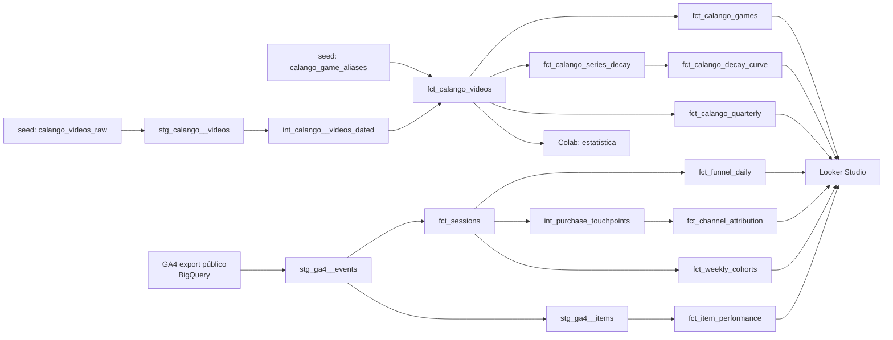

# 📊 calango-analytics

**O que faz um vídeo de gameplay ter mais views?** Análise de dados dos **2.960 vídeos** do canal [@CalangoLive](https://www.youtube.com/@CalangoLive/videos), da coleta à estatística, com **BigQuery, dbt, Looker Studio e Python**. Inclui também um módulo de **web analytics** com o export público do GA4 de um e-commerce.


[](https://colab.research.google.com/github/jmartellet/gameplay-studies/blob/main/calango-analytics/notebooks/calango_channel_analysis.ipynb)

> 📈 **Dashboard:** _link do Looker Studio aqui_

## O problema

Quem faz live e sobe VOD no YouTube decide toda semana **o que jogar e por quanto tempo**, quase sempre no feeling:

1. Uma série nova estreia bem, mas não fica claro quanto da audiência sobra no episódio 5 ou no 10.
2. Alguns jogos ocupam semanas de agenda. É difícil saber se eles trazem audiência ou só preenchem horário.
3. Mudanças de formato (título, collab, desafio) parecem funcionar, mas fica a dúvida se é o formato ou a época.

## O que o projeto responde

| Pergunta | Onde |
|---|---|
| Quanto da audiência do episódio 1 sobra em cada episódio? | `fct_calango_series_decay`, `fct_calango_decay_curve` |
| Quais jogos dão mais views por vídeo, e quais ocupam agenda sem retorno? | `fct_calango_games` |
| Como o canal mudou ao longo dos anos? | `fct_calango_quarterly` |
| Collab, desafio, duração e estilo de título se associam a mais views? | `notebooks/calango_channel_analysis.ipynb` |

## Principais achados

> _Rascunho: reescrever com minhas palavras depois de rodar o notebook._

- **A audiência é concentrada:** 1% dos vídeos somam 20% das 95 milhões de views. O vídeo mediano tem cerca de 11 mil.
- **Séries perdem a maior parte do público depois do episódio 1:** na mediana, o episódio 2 mantém 40% das views do episódio 1, o 5 mantém 23% e o 10 mantém 16%. Em 101 de 105 séries longas, o episódio 1 é o mais visto.
- **Volume de conteúdo não é audiência:** Escape from Tarkov é o 2º jogo em número de vídeos (199), com mediana de 3,2 mil views. Among Us teve 11 vídeos e mediana de 483 mil.
- **Collab é o fator mais forte:** mantendo ano, gênero, duração e formato constantes, vídeos com outros streamers têm cerca de 4x as views dos vídeos solo. Episódio 1 tem cerca de 3,6x; formato de desafio, cerca de +24%.
- **Cuidado com a correlação:** títulos em CAIXA ALTA parecem 34% piores, mas dentro do mesmo ano (2023, 2024) a diferença some (p > 0,8). O que pesava era a época, não o título.

Tudo acima é associação em dados observacionais, não causa. As views são acumuladas, e a data dos vídeos com mais de um ano é estimada (veja *Limitações*).

## Stack e técnicas

**SQL / dbt (BigQuery)**
- Parse de texto ("2:15:22", "3.9 thousand views") com `REGEXP_EXTRACT`, `SPLIT` e `SAFE_CAST`
- Data de publicação estimada a partir de "há 2 anos": interpolação dentro de cada faixa e `MIN()` acumulado para preservar a ordem, com teste que garante as duas coisas
- Seed com 69 padrões regex que unificam variações de título ("TAROV", "SCAPE FROM TARKOV", "CS:GO COM OS AMIGOS") em jogo e gênero
- Queda de audiência por episódio com `FIRST_VALUE` e `LAG` sobre uma `WINDOW` nomeada
- Módulo GA4: `UNNEST` de `event_params`, sessionização, funil, channel grouping (macro), **5 modelos de atribuição** gerados por um loop Jinja, retenção por coorte

**Estatística (Python, Colab)**
- Mann-Whitney, exemplo de confundimento (estilo de título × época) e regressão OLS em log(views) com erros robustos
- [Notebook de teste A/B](notebooks/ga4_ab_test.ipynb): tamanho de amostra, teste A/A, SRM, z-test, bootstrap e simulação de *peeking*

## Arquitetura



## Estrutura

```
calango-analytics/
├── models/youtube/    staging → intermediate → marts do canal
├── models/ga4/        staging → intermediate → marts do e-commerce
├── seeds/             vídeos coletados + mapa regex título → jogo/gênero
├── macros/            channel_group(): agrupamento de canais estilo GA4
├── tests/             testes singulares (datas, atribuição, coortes)
├── notebooks/         análise do canal + teste A/B
├── sql_exercises/     11 exercícios de SQL com resposta comentada
├── data/              marts exportados (o notebook roda sem BigQuery)
├── docs/              roteiro do dashboard
└── scripts/           checagem dos modelos usada no CI
```

## Como rodar

Tudo pelo navegador e de graça (BigQuery sandbox, dbt Cloud, Colab e Looker Studio). Passo a passo em [`GUIA.md`](GUIA.md).

**CI:** a cada push, o GitHub Actions executa os modelos do YouTube em DuckDB (traduzindo o SQL do BigQuery com sqlglot) e checa a sintaxe dos modelos GA4: `python scripts/check_models.py`.

## Limitações

- **Coleta:** página pública do canal em 23/11/2026. As views são os valores arredondados que o YouTube exibe ("3,9 mil").
- **Datas:** a página mostra só idade relativa. Para vídeos com mais de um ano, a data é estimada pela posição na lista.
- **Views acumuladas:** vídeos antigos tiveram mais tempo para somar views. A regressão controla o ano, mas não elimina o viés.
- **Observacional:** sem grupo de controle. O teste real para uma hipótese de título seria um A/B de título ou thumbnail.
- **GA4:** o dataset é ofuscado pelo Google (valores como `<Other>` e `(data deleted)`), e o experimento do notebook de A/B é simulado sobre usuários reais.
