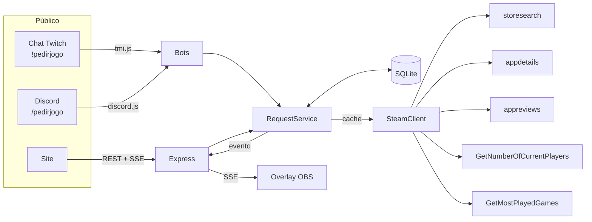

# 🎮 pedirjogo

**Fila de pedidos de jogos para streamers.** Os inscritos buscam o jogo direto na Steam e votam; o streamer vê, num só lugar, o que o público quer jogar *e* como cada jogo está na Steam (avaliações, gente jogando agora, posição no top 100). Funciona pelo site, pelo chat da Twitch (`!pedirjogo`) e pelo Discord (`/pedirjogo`).


## O problema

Hoje o fluxo costuma ser:

1. O público sugere jogos soltos no Discord ou no chat — repetidos, com nomes errados, sem ordem.
2. O streamer junta tudo na mão e vai na Steam pesquisar um por um para saber se o jogo é bom, quanto custa, se está em alta.

## A solução

| Antes | Com o pedirjogo |
|---|---|
| Sugestões espalhadas em mensagens | Uma fila única, ordenada por votos |
| "Hollow Night", "hk", "hollow knight 2" | Busca na Steam → todo pedido vira um AppID exato |
| Mesma pessoa pedindo 10 vezes | 1 voto por conta, garantido pelo banco |
| Pesquisar cada jogo na Steam | Avaliações, jogadores agora e ranking já no card |
| Ficar copiando link no chat | `!pedirjogo hades` → bot registra e responde com o link direto |

## Funcionalidades

- 🔎 **Busca na Steam** com resultados enquanto digita (preço em R$)
- 👍 **Upvote com bloqueio de duplicados** — `PRIMARY KEY (jogo, usuário)` no SQLite
- 🔐 **Login com Twitch ou Discord** (OAuth2) — a mesma conta vale no site e no bot
- 📊 **Dados da Steam no card**: % de avaliações positivas, jogadores agora, posição no top 100 mais jogados
- 🤖 **Bot da Twitch**: `!pedirjogo`, `!pedirjogo <nome|appid|link>`, `!votar`, `!top`
- 💬 **Bot do Discord**: `/pedirjogo` com autocomplete da Steam, `/top`, `/fila`
- ⚡ **Tempo real** via Server-Sent Events — voto no chat aparece no site na hora
- 📺 **Overlay para OBS** (`/overlay.html`) com o top da fila, fundo transparente
- 🛠️ **Painel do streamer**: marcar como jogado / recusado / reabrir

## Como funciona



**Pedir = votar.** Quando alguém pede um jogo que ainda não está na fila, ele entra com o voto dessa pessoa. Se já está, o pedido conta como voto. Se a pessoa já votou, nada muda (e o bot avisa).

**Identidade única.** O `user-id` que a Twitch manda junto com cada mensagem do chat é o mesmo ID que o login com Twitch devolve no site. Então votar pelo chat e depois pelo site é reconhecido como a mesma pessoa.

### Dados da Steam

A Steam não tem uma API oficial de busca por nome, então o projeto usa os endpoints JSON que a própria loja usa, mais endpoints públicos da Web API que **não precisam de chave**:

| Dado | Endpoint |
|---|---|
| Busca por nome | `store.steampowered.com/api/storesearch` |
| Nome, imagem, gêneros, preço | `store.steampowered.com/api/appdetails` |
| Avaliações | `store.steampowered.com/appreviews/{appid}?json=1` |
| Jogando agora | `ISteamUserStats/GetNumberOfCurrentPlayers/v1` |
| Top 100 mais jogados | `ISteamChartsService/GetMostPlayedGames/v1` |

Os endpoints da loja não são documentados e têm limite de requisições, por isso há três camadas de proteção: cache em memória (busca 5 min, detalhes 10 min, ranking 1 h), cache no banco (dados do jogo valem 6 h e são atualizados em segundo plano) e deduplicação de chamadas simultâneas para o mesmo jogo. Se a Steam cair, a fila continua funcionando com os últimos dados salvos.

## Rodando localmente

Requisitos: **Node.js 22+**.

```bash
git clone https://github.com/jmartellet/gameplay-studies.git
cd gameplay-studies/pedirjogo
npm install
cp .env.example .env    # preencha o que for usar
npm run dev             # http://localhost:3000
```

Sem nada configurado, o site já sobe e mostra a fila — só não dá para votar até configurar pelo menos um login.

### 1. Login com Twitch

1. Crie um app em <https://dev.twitch.tv/console/apps> (categoria: Website Integration).
2. Em **OAuth Redirect URLs** coloque `http://localhost:3000/auth/twitch/callback`.
3. Copie o Client ID e gere um Client Secret → `TWITCH_CLIENT_ID` e `TWITCH_CLIENT_SECRET`.

### 2. Login com Discord

1. Crie um app em <https://discord.com/developers/applications>.
2. Em **OAuth2 → Redirects** adicione `http://localhost:3000/auth/discord/callback`.
3. Copie Client ID e Client Secret → `DISCORD_CLIENT_ID` e `DISCORD_CLIENT_SECRET`.

### 3. Bot da Twitch

1. Escolha a conta do bot (pode ser a sua).
2. Gere um token de usuário com os escopos `chat:read chat:edit` — por exemplo com o [Twitch CLI](https://dev.twitch.tv/docs/cli/): `twitch token -u -s "chat:read chat:edit"`.
3. Preencha `TWITCH_BOT_USERNAME`, `TWITCH_BOT_OAUTH_TOKEN` e `TWITCH_CHANNEL`.

### 4. Bot do Discord

1. No mesmo app do passo 2, aba **Bot** → **Reset Token** → `DISCORD_BOT_TOKEN`.
2. Convide o bot: **OAuth2 → URL Generator**, escopos `bot` e `applications.commands`.
3. (Opcional) coloque o ID do seu servidor em `DISCORD_GUILD_ID` para os comandos aparecerem na hora.
4. Registre os comandos: `npm run discord:register`.

Não é preciso ligar nenhum *privileged intent*: o bot usa só slash commands.

### 5. Você como streamer

Coloque seu login da Twitch em `ADMIN_TWITCH_LOGINS` (e/ou seu ID do Discord em `ADMIN_DISCORD_IDS`). Ao entrar no site você vê os botões **Jogado / Recusar** e o link do overlay.

### 6. Overlay no OBS

Adicione uma fonte **Navegador** com `http://localhost:3000/overlay.html?limit=5` (largura 460). Use `&compact=1` para esconder as imagens.

## Comandos dos bots

| Twitch | Discord | O que faz |
|---|---|---|
| `!pedirjogo` | `/fila` | Manda o link da página de votação |
| `!pedirjogo hades` | `/pedirjogo jogo:Hades` | Pede/vota e responde com o link direto do jogo |
| `!pedirjogo 1145360` ou link da loja | (autocomplete) | Pedido exato pelo AppID |
| `!votar hades` | — | Igual ao `!pedirjogo <nome>` |
| `!top` / `!fila` | `/top` | Top da fila |

Exemplo no chat:

```
viewer: !pedirjogo hollow knight
bot:    @viewer pediu Hollow Knight! Entrou na fila em #3 → https://seusite.com/?jogo=367520
```

O link `?jogo=APPID` abre o site já com o jogo destacado (ou com um botão "Pedir este jogo" se ainda não estiver na fila).

## API

| Método | Rota | Descrição |
|---|---|---|
| `GET` | `/api/me` | Usuário logado, se é admin, provedores e bots ativos |
| `GET` | `/api/steam/search?q=` | Busca na Steam (marca o que já está na fila) |
| `GET` | `/api/steam/app/:appid` | Prévia de um jogo |
| `GET` | `/api/games?status=pendente\|jogado\|recusado` | Ranking |
| `GET` | `/api/games/:appid` | Um jogo da fila |
| `POST` | `/api/games/:appid/vote` | Pede/vota (login) |
| `DELETE` | `/api/games/:appid/vote` | Remove o voto (login) |
| `PATCH` | `/api/games/:appid` | `{ "status": "jogado" }` (streamer) |
| `GET` | `/api/stream` | Server-Sent Events: avisa quando o ranking muda |

Requisições que alteram dados exigem `Content-Type: application/json`.

## Testes

```bash
npm test          # 40 testes (Vitest + Supertest)
npm run typecheck
```

Os testes não acessam a internet: a Steam é simulada com um `fetch` falso e o OAuth da Twitch/Discord também. Cobrem, entre outros: bloqueio de voto duplicado (inclusive direto no banco), ordem do ranking e desempate, chamadas simultâneas à Steam, cache e atualização de dados velhos, Steam fora do ar, fluxo OAuth completo, proteção do `state`, open redirect, permissões do streamer e respostas dos comandos de chat.

## Estrutura

```
src/
  config.ts            variáveis de ambiente validadas com zod
  db.ts                schema SQLite
  steam.ts             cliente da Steam + cache
  service.ts           regras de negócio: pedir, votar, ranking, status
  auth.ts              OAuth2 Twitch/Discord (sem Passport, à mão)
  routes.ts            API REST + SSE
  server.ts            monta o Express
  index.ts             sobe servidor + bots
  bots/commands.ts     lógica dos comandos (testável, sem rede)
  bots/twitch.ts       tmi.js
  bots/discord.ts      discord.js
public/                front-end sem framework (HTML + CSS + JS)
test/                  testes
```

## Decisões e limitações conhecidas

- **Twitch e Discord são contas separadas.** Quem tem as duas consegue votar duas vezes no mesmo jogo. Próximo passo natural: vincular contas.
- **Um canal por instância.** Para vários streamers seria preciso uma tabela `channels` e separar filas.
- **Chat da Twitch via IRC (tmi.js).** Funciona e é simples; a Twitch recomenda EventSub para bots novos, que exige um app com mais permissões.
- **Endpoints da loja da Steam não são oficiais** e podem mudar. Toda a integração está isolada em `src/steam.ts`.
- **SQLite** é suficiente para um canal; para escalar, o `RequestService` é o único lugar que fala SQL.

## Roadmap

- [ ] Vincular conta Twitch + Discord
- [ ] Peso extra para subs / cargos do Discord
- [ ] Multi-canal
- [ ] Limite de pedidos abertos por pessoa
- [ ] Histórico: quando cada jogo foi jogado e quanto tempo ficou na fila
- [ ] Deploy com Docker

## Licença

MIT — veja o [LICENSE](../LICENSE) na raiz do repositório.
